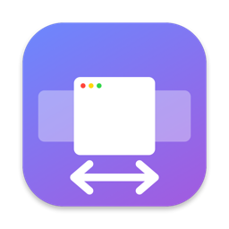
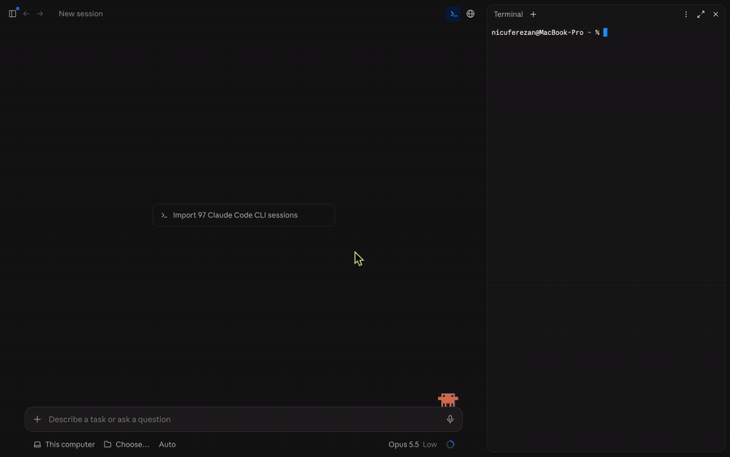
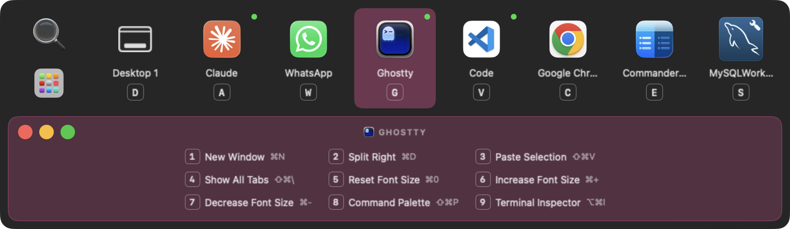
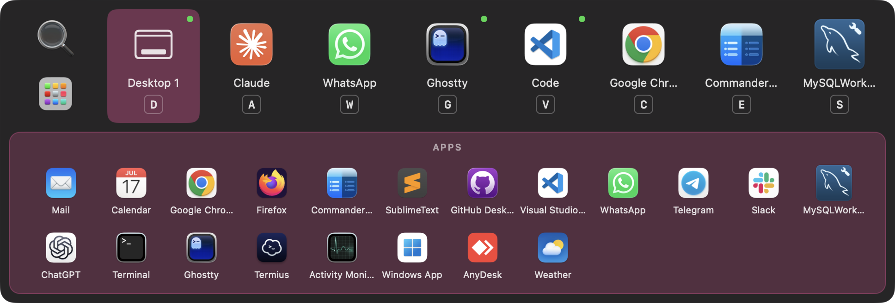
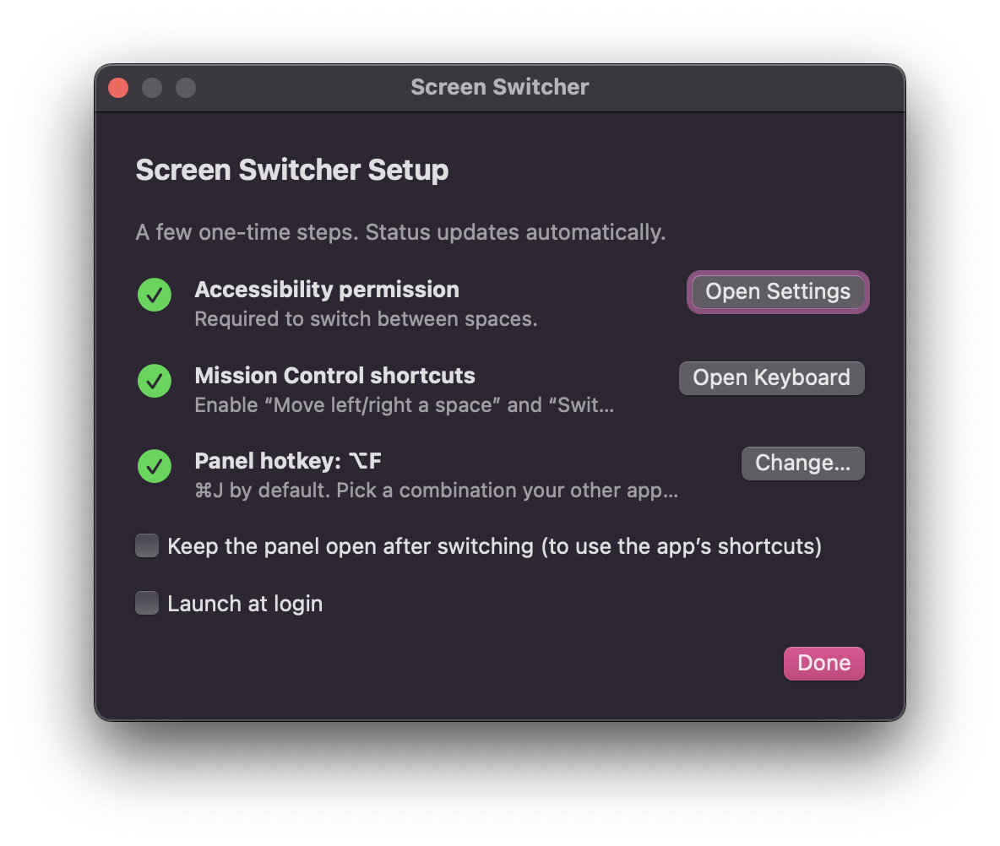
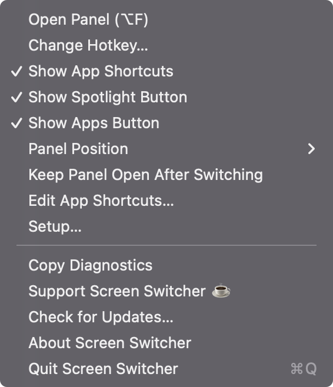

  

<h1 align="center">Screen Switcher</h1>

  Jump to any desktop or full-screen app on your Mac with one key. 
  <a href="https://github.com/nicuferezan/screen-switcher/releases/latest"><b>Download the latest DMG</b></a>

  

---

## What it does

Press **⌘J** (or your own hotkey) and a panel shows every space you have — regular desktops and full-screen apps, including both apps of a Split View — with their real icons.

- Press the app's **letter** (C = Chrome, M = MySQL…) to jump straight to it.
- Or click, use ←/→ + Enter, or the position number 1–9.
- Set your own letters: right-click an app → **Set Shortcut…**.
- Lives in the menu bar, no Dock icon. Optional launch at login.

### Shortcuts of the app in front

Under the spaces, the panel lists the menu shortcuts of the app you were using. Press **1–9** to run one without hunting through menus; the traffic lights minimise, zoom or close its window.

### Spotlight and your Dock's apps

The first tile opens **Spotlight** (top) or **Apps** (bottom). Apps shows the apps pinned in your Dock right in the panel; click one to open it — a closed app opens straight in full screen, an app already open is brought forward as it is. Turn the buttons on or off from the menu bar icon.

### Where the panel opens

Centered on the screen (default) or just above the mouse pointer — pick it in **Setup** or the menu bar icon → **Panel Position**.

### Menu bar

Open the panel, change the hotkey, toggle the app shortcuts, Spotlight and Apps buttons, or copy diagnostics for a bug report.

## Install

1. Download `ScreenSwitcher-x.y.z.dmg` from [Releases](https://github.com/nicuferezan/screen-switcher/releases/latest).
2. Open it and drag **Screen Switcher** into **Applications**.
3. Open it. The first time, macOS will block it because the app isn't notarized yet:
   - go to **System Settings → Privacy & Security** and click **Open Anyway**, or
   - run `xattr -cr "/Applications/ScreenSwitcher.app"` in Terminal.
4. Follow the **Setup** window:
   - allow **Accessibility** (needed to switch spaces),
   - enable **Mission Control** shortcuts (“Move left/right a space”, “Switch to Desktop N”),
   - the panel opens with **⌘J**; change it from the menu bar icon → **Change Hotkey…** if you need ⌘J elsewhere.

Requires macOS 13 Ventura or later, Apple silicon or Intel.

## Support

Screen Switcher is free. If it saves you time, [buy me a coffee ☕](https://buymeacoffee.com/nicuferezao) — it helps pay for the Apple Developer account so future versions can open without the security warning.

## Feedback

Found a bug or want a feature? [Open an issue](https://github.com/nicuferezan/screen-switcher/issues).

---

Made by <a href="https://binary.company">binary.company</a>. 
Screen Switcher uses undocumented macOS APIs to read the list of spaces, so a macOS update may break it until a new version is released.
